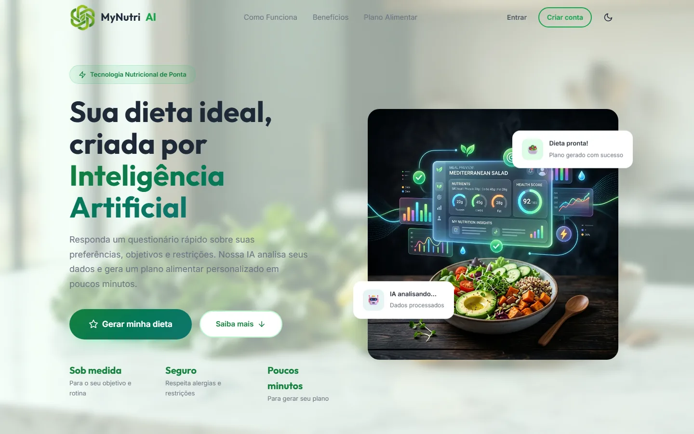
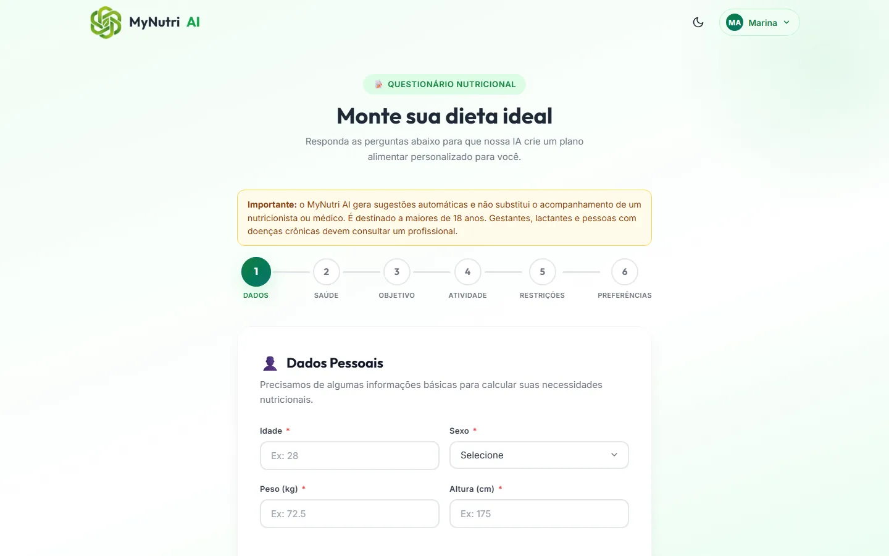
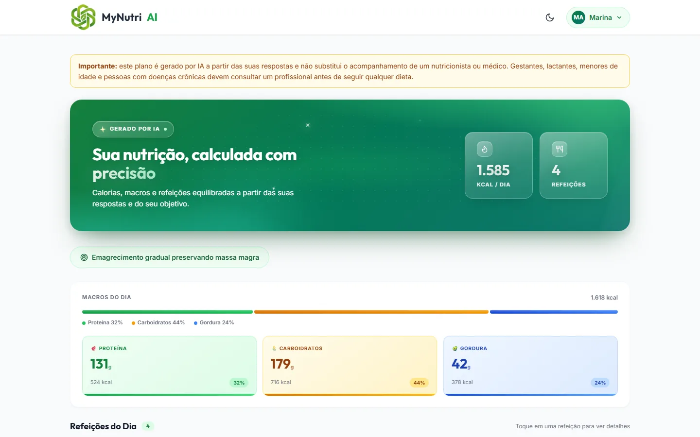
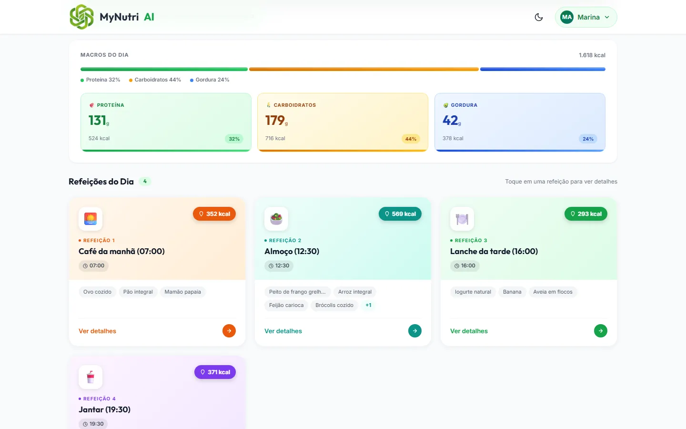
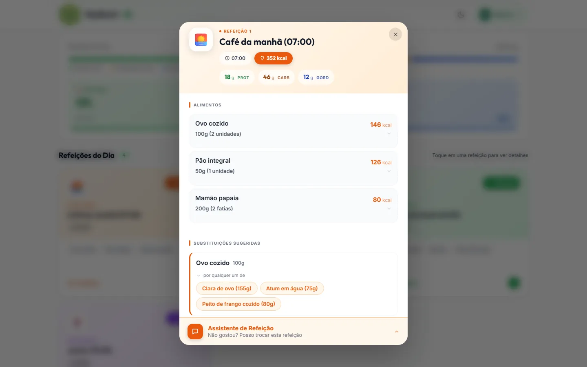
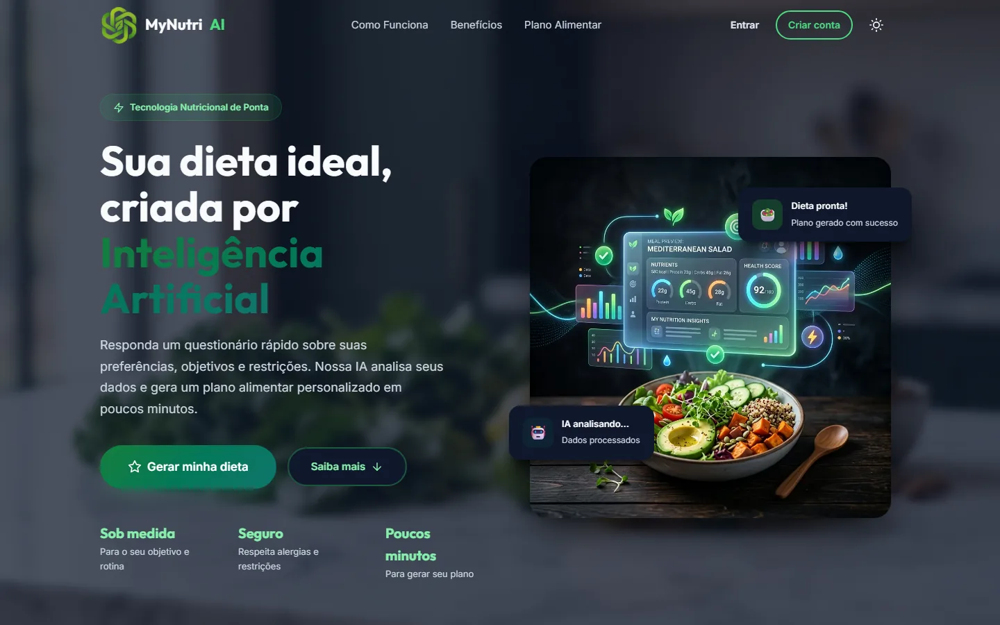
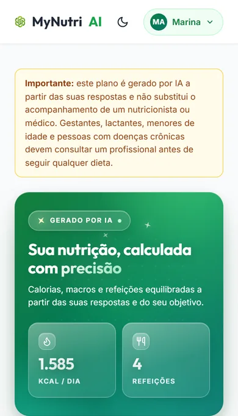
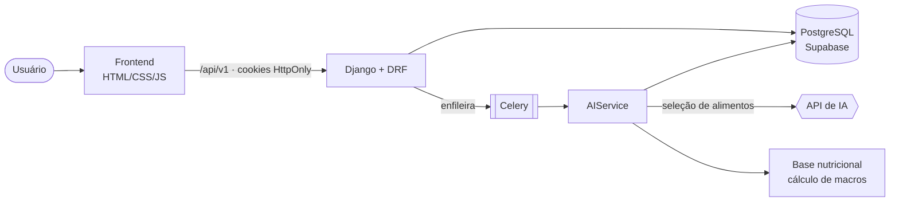
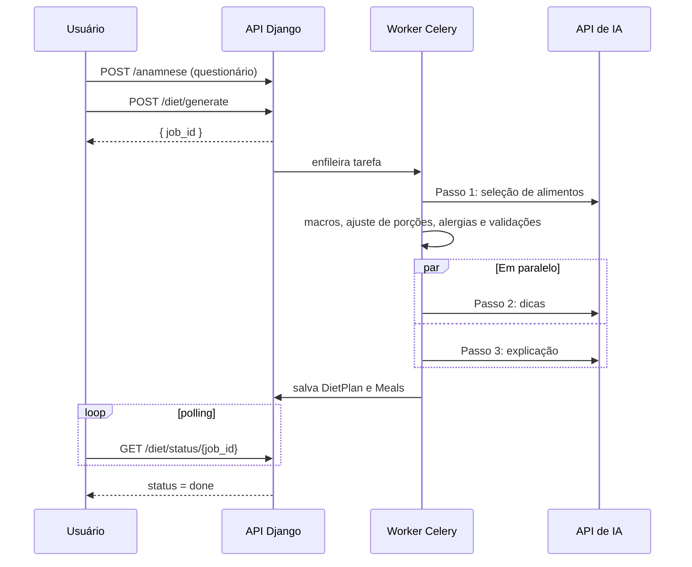

<div align="center">


# MyNutri AI

**Planos alimentares personalizados, gerados por Inteligência Artificial em poucos minutos.**

[](https://mynutri-ai-plataform.vercel.app)

[](https://github.com/gabrielmrezende/mynutri-ai-plataform/actions/workflows/ci.yml)


[Site](https://mynutri-ai-plataform.vercel.app) ·
[Funcionalidades](#-funcionalidades) ·
[Rodando localmente](#-rodando-localmente) ·
[Arquitetura](#-arquitetura) ·
[Documentação](docs/)

<br />



</div>

> [!WARNING]
> O MyNutri AI gera sugestões automáticas e **não substitui o acompanhamento de um nutricionista ou médico**.
> O serviço é destinado a maiores de 18 anos. Gestantes, lactantes e pessoas com doenças crônicas devem consultar um profissional.

---

## 📑 Sumário

- [Sobre o projeto](#-sobre-o-projeto)
- [Funcionalidades](#-funcionalidades)
- [Screenshots](#-screenshots)
- [Tecnologias](#-tecnologias)
- [Arquitetura](#-arquitetura)
- [Rodando localmente](#-rodando-localmente)
- [Variáveis de ambiente](#-variáveis-de-ambiente)
- [Testes e qualidade](#-testes-e-qualidade)
- [Deploy](#-deploy)
- [API](#-api)
- [Segurança e privacidade](#-segurança-e-privacidade)
- [Estrutura do projeto](#-estrutura-do-projeto)
- [Autores](#-autores)

---

## 💡 Sobre o projeto

O usuário responde a um questionário nutricional (dados pessoais, saúde, objetivo, nível de atividade, restrições e preferências) e o MyNutri AI monta um plano alimentar completo, com refeições, quantidades, calorias, macronutrientes e substituições.

A IA **escolhe os alimentos**; os **números são calculados pelo backend**, de forma determinística:

1. **Meta calórica** pela fórmula de Mifflin-St Jeor, com déficit ou superávit limitado conforme o objetivo.
2. **Seleção de alimentos** pela IA, respeitando preferências, restrições e alergias.
3. **Cálculo de macros** a partir de uma base nutricional própria, com ajuste das porções à meta e arredondamento para medidas caseiras.
4. **Validações de segurança**: rejeita planos com alérgenos, restrições violadas ou distribuição de macros fora de limites fisiológicos.
5. **Dicas e explicações** personalizadas geradas em paralelo.

---

## ✨ Funcionalidades

| | |
|---|---|
| 📋 **Questionário em 6 etapas** | Validação por campo, rascunho salvo automaticamente e pré-preenchimento com a última resposta |
| 🩺 **Triagem de saúde** | Bloqueia casos que exigem acompanhamento profissional (gestação, doença renal, transtorno alimentar…) |
| 🤖 **Geração assíncrona** | Fila com Celery e acompanhamento do progresso; dá para sair da página e voltar |
| 🎯 **Plano completo** | Calorias e macros por refeição e por alimento, em gramas e em medidas caseiras |
| 🛡️ **Alergias e restrições** | Detecção por família de alimentos (ex.: *leite* → queijo, iogurte, whey) e restrições como vegetariano ou sem lactose |
| 🔄 **Trocar refeição** | Regeneração pontual com IA (3 por dia por plano) e opção de desfazer |
| 🔁 **Substituições** | Equivalências sugeridas para cada alimento, compatíveis com o perfil do usuário |
| 📄 **Exportação em PDF** | Plano pronto para imprimir ou compartilhar |
| 📊 **Histórico** | Todos os planos gerados, com macros resumidos |
| 🔐 **Login com e-mail ou Google** | Sessão em cookies HttpOnly, troca de senha e exclusão de conta |
| 🌙 **Dark mode** | Segue a preferência do sistema e lembra a escolha do usuário |
| ♿ **Acessível e responsivo** | Navegação por teclado, foco visível, `prefers-reduced-motion` e layout mobile-first |

---

## 📸 Screenshots

<table>
  <tr>
    <td width="50%"></td>
    <td width="50%"></td>
  </tr>
  <tr>
    <td align="center"><b>Questionário em etapas</b></td>
    <td align="center"><b>Resumo do plano: calorias e macros</b></td>
  </tr>
  <tr>
    <td width="50%"></td>
    <td width="50%"></td>
  </tr>
  <tr>
    <td align="center"><b>Refeições do dia</b></td>
    <td align="center"><b>Detalhes, substituições e troca de refeição</b></td>
  </tr>
</table>

<details>
<summary><b>🌙 Dark mode e 📱 versão mobile</b></summary>
<br />
<p align="center">
  
  &nbsp;
  
</p>
</details>

> As telas do plano mostram um usuário de demonstração.

---

## 🛠️ Tecnologias

| Camada | Tecnologias |
|---|---|
| **Backend** | Python 3.13, Django 6, Django REST Framework, SimpleJWT, Celery |
| **Banco de dados** | PostgreSQL no Supabase |
| **Cache e fila** | Redis (opcional); sem Redis, cache no banco e tarefas síncronas |
| **IA** | Qualquer API compatível com OpenAI (padrão: `gpt-4o-mini`) |
| **Frontend** | HTML, CSS e JavaScript puros, servidos pelo próprio Django |
| **PDF** | ReportLab |
| **Testes** | pytest, pytest-cov, Playwright (E2E), ruff, bandit, pip-audit |
| **Infra** | Vercel (produção), Render (blueprint alternativo), GitHub Actions, Sentry |

---

## 🏗️ Arquitetura



**Fluxo de geração de dieta:**



> Sem broker configurado (dev ou Vercel), a tarefa roda de forma síncrona na própria requisição.

Mais detalhes em [`docs/ARCHITECTURE.md`](docs/ARCHITECTURE.md) e [`docs/PROMPTS.md`](docs/PROMPTS.md).

---

## 🚀 Rodando localmente

### Pré-requisitos

- **Python 3.13**
- Um banco **PostgreSQL**: um projeto no [Supabase](https://supabase.com) ou um Postgres local
- Uma chave de API de IA compatível com OpenAI
- *(Opcional)* Node.js 20+ para os testes E2E e Redis para a fila do Celery

### Passo a passo

```bash
# 1. Clone o repositório
git clone https://github.com/gabrielmrezende/mynutri-ai-plataform.git
cd mynutri-ai-plataform

# 2. Crie e ative o ambiente virtual
python -m venv venv
source venv/bin/activate        # Windows: venv\Scripts\activate

# 3. Instale as dependências (produção + ferramentas de desenvolvimento)
pip install -r requirements-dev.txt

# 4. Configure as variáveis de ambiente
cp .env.example .env            # depois preencha os valores obrigatórios

# 5. Crie as tabelas
python manage.py migrate

# 6. Suba o servidor
python manage.py runserver
```

Acesse **http://127.0.0.1:8000**. Para o painel administrativo, crie um usuário com `python manage.py createsuperuser` e entre em `/admin/`.

<details>
<summary><b>Rodar a fila assíncrona com Celery (opcional)</b></summary>

Defina `CELERY_BROKER_URL=redis://localhost:6379/0` no `.env` e, em outro terminal:

```bash
celery -A mynutri worker --loglevel=info
```

Sem `CELERY_BROKER_URL`, a geração roda de forma síncrona.
</details>

---

## 🔑 Variáveis de ambiente

As variáveis obrigatórias são validadas na inicialização: o servidor não sobe sem elas. O arquivo [`.env.example`](.env.example) traz todas comentadas.

| Variável | Obrigatória | Descrição |
|---|:---:|---|
| `SECRET_KEY` | ✅ | Chave secreta do Django |
| `DATABASE_URL` | ✅ | Connection string do Postgres. No Supabase, use o *Session pooler* (porta 5432) |
| `AI_API_KEY` | ✅ | Chave da API de IA |
| `AI_API_URL` | ✅ | Endpoint de chat completions (`http`/`https`) |
| `GOOGLE_CLIENT_ID` | ✅ | Client ID OAuth do Google (login com Google) |
| `AI_MODEL` | | Modelo de IA. Padrão: `gpt-4o-mini` |
| `DEBUG` | | `True` em desenvolvimento. Padrão: `False` |
| `ALLOWED_HOSTS` | | Domínios extras (os do Vercel e do Render são incluídos automaticamente) |
| `CACHE_URL` | | Redis para cache e rate limiting. Sem ele, em produção, o cache fica no banco |
| `CELERY_BROKER_URL` | | Redis da fila do Celery. Sem ele, a geração é síncrona |
| `SENTRY_DSN` | | Monitoramento de erros |
| `EMAIL_HOST`, `EMAIL_HOST_USER`, `EMAIL_HOST_PASSWORD`, `CONTACT_EMAIL` | | Envio do formulário de contato |

---

## 🧪 Testes e qualidade

```bash
pytest                                   # testes unitários e de API (SQLite em memória)
pytest --cov --cov-fail-under=85         # com cobertura mínima de 85%
ruff check .                             # lint
npm ci && npx playwright install chromium
npx playwright test                      # testes E2E no navegador
```

Os testes usam [`mynutri/test_settings.py`](mynutri/test_settings.py) e não precisam de `.env` nem de chaves reais: a IA é simulada.

O **GitHub Actions** roda em cada push e pull request: lint, `check --deploy`, testes com cobertura, migrations pendentes, testes E2E, `bandit` e `pip-audit`.

---

## ☁️ Deploy

**Produção: [Vercel](https://mynutri-ai-plataform.vercel.app)** + Supabase

- O [`vercel.json`](vercel.json) roda `migrate` e `createcachetable` no build.
- Funções com até 300 s de duração, porque a geração roda de forma síncrona.
- Configure as variáveis obrigatórias no painel do Vercel.

**Alternativa: Render**

O [`render.yaml`](render.yaml) é um blueprint com Web Service, Worker Celery e Key Value (Redis). O banco continua sendo o Supabase.

Health check: `GET /health/` (verifica a conexão com o banco).

---

## 🔌 API

Prefixo `/api/v1/`. Requisições autenticadas usam cookies HttpOnly. Métodos que alteram dados exigem o header `X-Requested-With: XMLHttpRequest`.

| Método | Endpoint | Descrição |
|---|---|---|
| `POST` | `/auth/register` · `/auth/login` · `/auth/google` | Cadastro e login |
| `POST` | `/auth/token/refresh` · `/auth/logout` | Renovação e encerramento da sessão |
| `GET` `PATCH` | `/user/profile` | Perfil do usuário |
| `POST` | `/user/change-password` · `/user/delete-account` | Senha e exclusão de conta |
| `POST` | `/anamnese` · `GET /anamnese/last` | Questionário nutricional |
| `POST` | `/diet/generate` · `GET /diet/status/<job_id>` | Geração assíncrona e polling |
| `GET` | `/diet` · `/diet/list` · `/diet/<id>` · `/diet/<id>/pdf` | Plano atual, histórico, detalhe e PDF |
| `PATCH` | `/diet/<id>/meal/<meal_id>/regenerate` | Troca uma refeição com IA |
| `POST` | `/diet/<id>/meal/<meal_id>/undo` | Desfaz a última troca |
| `GET` `POST` | `/testimonials` · `POST /contact` | Depoimentos e contato |

Contratos completos, com exemplos de requisição e resposta, em [`docs/API.md`](docs/API.md).

---

## 🔒 Segurança e privacidade

- **Sessão:** JWT em cookies `HttpOnly`/`Secure`/`SameSite`, com rotação e blacklist do refresh token no logout e na troca de senha.
- **Login com Google:** o `id_token` é validado (assinatura, `aud`, `iss` e `email_verified`).
- **Proteções HTTP:** Content-Security-Policy, proteção anti-CSRF e cabeçalhos `Permissions-Policy` e `Referrer-Policy`.
- **Rate limiting por escopo:** login, geração de dieta, regenerações, contato e polling.
- **Dados de saúde:** são dados sensíveis (LGPD). Os logs e o Sentry nunca recebem conteúdo da anamnese, e o cadastro exige o aceite dos [Termos](https://mynutri-ai-plataform.vercel.app/termos/) e da [Política de Privacidade](https://mynutri-ai-plataform.vercel.app/privacidade/).
- **Entrada do usuário:** o texto livre é isolado nos prompts contra prompt injection, e o retorno da IA é sempre escapado no frontend e no PDF.

Veja [`docs/SECURITY.md`](docs/SECURITY.md).

---

## 📂 Estrutura do projeto

```text
mynutri-ai-plataform/
├── mynutri/              # Configuração Django: settings, urls, middleware de segurança, Celery
├── user/                 # Autenticação (e-mail e Google), perfil, contato e depoimentos
├── nutrition/            # Anamnese, geração de dieta, IA, base nutricional, PDF
│   ├── prompts/          # Prompts dos passos de IA
│   └── tests/            # Testes de serviço e de API
├── frontend/
│   ├── public/           # Páginas HTML
│   └── src/              # JS, CSS e imagens
├── e2e/                  # Testes Playwright
├── load-tests/           # Testes de carga (k6)
├── docs/                 # Documentação técnica e imagens do README
├── vercel.json           # Deploy no Vercel
├── render.yaml           # Blueprint do Render
└── requirements*.txt     # Dependências (produção e desenvolvimento)
```

---

## 🗺️ Roadmap

O histórico de versões e os próximos passos estão em [`docs/ROADMAP.md`](docs/ROADMAP.md).

---

## 👨‍💻 Autores

| | |
|---|---|
| **Gabriel Rezende** | [LinkedIn](https://www.linkedin.com/in/gabrielmrezende/) |
| **Carlos Alberto** | |
| **Arthur Hoffmann** | [LinkedIn](https://www.linkedin.com/in/arthur-hoffmann-a2383226b/) |
| **Pedro Antônio** | |

---

## 📄 Licença

© 2026 MyNutri AI. Projeto proprietário: o código não pode ser copiado, modificado ou redistribuído sem autorização dos autores.
